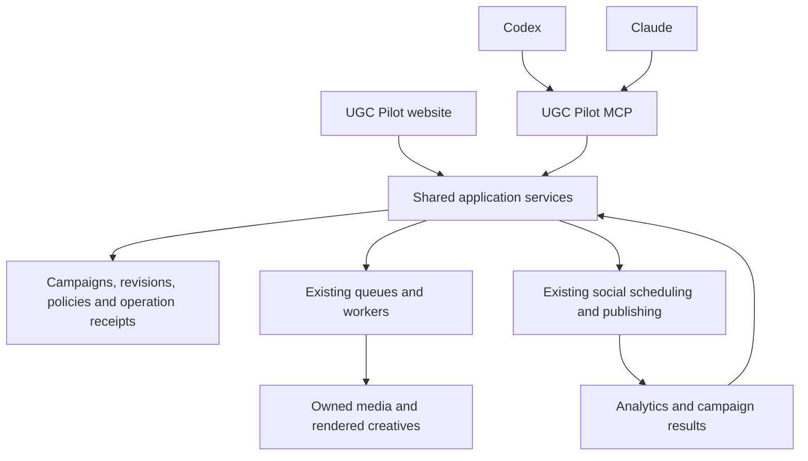

# Proposed agent-first marketing platform

Prepared 11 October 2026. This is an architecture proposal based on repository inspection, saved release reports, current official client documentation, and one live read-only MCP capabilities call. It does not implement or approve a production change.

For the concrete code-backed change list and implementation order, see `ide-access-implementation-checklist-2026-10-11.md`. For the standalone video-generation verdict and offline verification, see `mcp-video-code-capability-audit-2026-10-11.md`.

## Recommendation

The user's clarified primary requirement is complete operation of UGC Pilot from Codex, Claude, or another supported IDE agent. Ordinary creative work must not require visiting the website: the user can generate footage, supply local hook/demo files, upload them, attach them to a draft, edit and compose the video, retrieve the finished file, and ultimately schedule/publish through the same interface. Campaign planning is a later layer on this operational foundation.

Extend UGC Pilot into a marketing execution platform that users operate through Codex, Claude, or the website. Reuse the existing hosted MCP endpoint, plugin, authentication, media storage, credit reservations, queues, workers, scheduling services, and analytics integrations.

The website and MCP should call the same application services. The plugin supplies workflow instructions and a connection to those services. Campaign state, permitted spending, approvals, work receipts, and outputs belong in UGC Pilot so they can survive chat loss and move between clients.

The external agent chooses and explains a marketing plan. UGC Pilot validates and executes the concrete operations. Access through an agent should preserve the same ownership, plan, credit, feature availability, rendering, and publishing rules as access through the website.

## Local files and completion inside the IDE

The first user-facing flow should accept a request such as: "Upload demo.mp4 and hook.mp4 from this workspace, attach the demo after the hook, add these exact words, and return the finished vertical video here." It must also support generating the hook instead of uploading one.

The existing MCP already has `create_upload` and `confirm_upload`. Its documented flow is reservation, direct transfer of real bytes using a signed PUT URL, then confirmation. The server cannot read a user's local path itself. The IDE agent or a local companion helper must read and upload that file with the user's filesystem authorization. File bytes should travel directly to storage, outside model text/tool arguments.

Support the existing direct-transfer flow first in Codex and Claude Code. A small shared CLI/helper can later standardize metadata probing, uploads, upload receipts, interrupted confirmation recovery, and downloads across IDEs. Authentication must use the supported UGC Pilot connection flow; do not depend on copying a host's hidden OAuth tokens into a helper.

Generic MCP video uploads currently become `upload` or `influencer_upload` assets. Dedicated demo registration, hook/demo role assignment, attachment to a draft, and composition need explicit contracts that reuse the current app's owned-media validation. Do not treat every uploaded video as already present in the app's dedicated Demo library.

A generic ready owned video can already serve as the demo input to the existing Explore finisher. Dedicated Demo registration is needed for dedicated-library and legacy Trending parity, rather than being a prerequisite for that minimum composition. MCP attachment/render entrypoints remain missing.

Expose structured operations to select a hook, attach or replace a demo, edit timing/text/audio, submit a render, retrieve its status, and download its actual output. A working draft must be saved in the backend so the user can continue in another IDE; an explicit multi-post campaign is not a prerequisite for this first flow.

Test complete operation without opening UGC Pilot's website. Authentication and third-party consent may still require their standard sign-in UI. Other IDEs qualify for this experience when they support MCP plus authorized local-file access and binary transfer. Cloud-only clients need an attachment or supported transfer mechanism; a plugin cannot create filesystem access the host does not expose.

## Verified starting point

| Area | Evidence and practical consequence |
| --- | --- |
| Plugin | Local 0.1.2 package has eight workflows and portable, Codex, and Claude compatibility manifests. Saved private-release records describe the same eight workflows. This is a useful foundation, not full application coverage. |
| Shared endpoint | Package connects to `https://mcp.getugcpilot.com/mcp`. Both client families can use a remote MCP service; their distribution packages and installed-client acceptance remain separate. |
| Current tool surface | Twelve tools: profile, entitlements, capabilities, completed brand context, asset listing/retrieval, upload/confirmation/deletion, image/video generation, and generation status. |
| Live capabilities | The read-only production call during this planning session returned image/video availability, counts of 1/2/4, one image reference, video durations of 3–10 seconds, and no video references. No paid operation was performed. |
| Creative skills | Hook words, hook footage direction, wall-of-text words, wall footage direction, and semantic slideshow copy are packaged. Skills provide instructions; they cannot render or publish without corresponding tools. |
| Current omissions | MCP does not expose exact overlay composition, finished slideshows, audio generation, full editor operations, scheduling, publication, or analytics. These require service adapters and contracts. |
| Browser-only slideshow export | Explore text export currently uses browser canvas in `lib/explore/slideshow-text-client.ts`. Complete IDE parity needs a server/worker text compositor in addition to the service adapters. |
| Job recovery | `lib/mcp/generation-tools.ts` restricts `get_job` to owned image/video jobs with MCP provenance. Website finishing and rendering jobs are outside that contract. Cross-client recovery needs a broader, explicitly designed operation interface. |
| Existing application services | Creative read/edit services, Explore finishing, scheduling, social connections, and analytics already exist. Some handlers include request authentication and need extraction into reusable services before MCP can call them. |
| Durable infrastructure | README and job services describe Supabase job state, GCP Cloud Tasks, Cloud Run workers, and Google Cloud Storage. Preserve this established stack in the first release. |
| Release evidence | Earlier reports record production generation/replay success and unresolved installed-host, fresh-account, transport, and directory acceptance items. Those reports do not prove every target client passes today. |

Relevant local evidence:

- `plugins/ugc-pilot/README.md`
- `docs/plugin-production-release-plan-2026-10-08.md`
- `docs/plugin-private-release-client-readiness-2026-10-09.md`
- `docs/plugin-0.1.2-download-release-2026-10-09.md`
- `docs/complete-release-2026-10-09.md`
- `lib/mcp/server.ts`, `lib/mcp/scopes.ts`, `lib/mcp/read-tools.ts`, `lib/mcp/generation-tools.ts`
- `lib/trending/creative-edit-service.ts`, `lib/explore/workflow-finishing-api.ts`, `lib/scheduling/service.ts`
- `CAROUSEL_CONTEXT.md`

## Relationship to the previous plan

The strongest recorded prior plan was staged plugin delivery: establish a reliable authenticated MCP with twelve bounded tools; package connection, generation and library workflows; add the five specialized creative skills; test generation receipts, replay, billing and host installation; then address distribution.

Keep that foundation. The new objective extends it from individual media generation to complete, persistent marketing workflows. I did not find a previously approved full-platform campaign architecture in the inspected reports, so the campaign design below is a new proposal.

## Shared operations and state

Introduce a shared application-service boundary with an authenticated actor, validated input, policy enforcement, and structured result. Website authentication and MCP OAuth are adapters into this boundary. The current MCP resolves an authenticated Firebase UID; preserve that identity and ownership model. Never accept the owner identity merely from model-generated input.

Extract existing request-bound business logic where necessary. Do not implement MCP by forwarding browser cookies to website routes, giving the agent database administration access, or copying renderer and publishing logic into plugin instructions.

Persist a campaign record containing:

- Owner and brand/profile reference, goal, audience, channel selections, dates, account timezone, and success metric.
- Versioned content plan, selected copy, references, creative drafts, renders, and final owned asset IDs.
- Budget limit, reservations and spend, authorization policy, and approvals tied to specific revisions.
- Operation IDs, child jobs, attempts, partial outcomes, publication targets, and actual delivery outcomes.
- Measurements, source timestamps, attribution limitations, and proposed follow-up experiments.

These are conceptual requirements, not finalized database migrations. Reuse existing tables and receipts where possible. New data must use explicit ownership checks and the appropriate database grants/RLS for the project's actual Firebase/server access model; do not blindly introduce Supabase Auth assumptions.

Typed operations should be small enough to inspect individually and broad enough to accomplish a user goal. Draft tool names below are proposals, not current callable tools.

| Capability | Proposed operations | Initial implementation boundary |
| --- | --- | --- |
| Workspace and brand | `get_workspace_context`, `get_workspace_capabilities`, `update_brand_context` | Return available actions, brand constraints, credits, account timezone, connection state, and resumable work. Add explicit brand-write authorization. |
| Campaigns | `create_campaign`, `get_campaign`, `update_campaign_plan` | Persist an inspectable plan and stable campaign ID. Make cross-client handoff possible. |
| Creative discovery | `list_creatives`, `get_creative`, `list_references` | Expose owned saved work and currently eligible catalogue references with stable IDs. |
| Editing and rendering | `create_creative_draft`, `update_creative_draft`, `render_creative` | Validate typed copy/timing/layout/audio edits and call the existing format-specific services and renderers. |
| Audio | `list_voices`, `generate_audio`, `attach_audio` | Reuse current account availability, audio ownership, reservation and duration rules. |
| Work recovery | `list_operations`, `get_operation`, `cancel_operation` | Cover approved workflow types irrespective of whether they started in the website or MCP. Preserve current `get_job` compatibility. Cancellation is best effort and reports settled charges/work already submitted. |
| Social delivery | `list_social_connections`, `prepare_schedule`, `commit_schedule`, `get_schedule`, `update_schedule`, `cancel_schedule` | Separate an inspectable schedule draft from dispatch. Preserve each platform's account eligibility, visibility choices, required settings and ownership rules. |
| Measurement | `get_performance_report` | Reuse existing Instagram/TikTok/YouTube integrations only where available. Return freshness, missing metrics and usable published-post associations. |

Keep existing tool names and schemas compatible. Add the broader workspace/operation surface explicitly instead of silently widening narrowly documented generation APIs. Capability discovery must advertise live account and deployment availability, including rollout flags and platform restrictions.

## Skills and rendering

Keep the eight existing workflows and extend them with campaign planning, finished creative production, scheduling, and performance review instructions. A top-level marketing skill can select specialist workflows by deliverable. Tool authorization and spending policy remain server responsibilities.

Exact selected words become typed overlay/slide data and go through the existing compositor. The footage model should not be responsible for reliably reproducing final text. Slideshow copy from the existing plugin is semantic content, not the application Carousel worker contract.

Build explicit adapters for each supported format. Read and preserve `CAROUSEL_CONTEXT.md` before Carousel implementation, and update it when a product/architecture decision is accepted and changes that system. This proposal does not change Carousel readiness, sourcing, rotation, schemas, or rendering rules.

## Delegation and control

Support an inspectable plan followed by execution within a saved policy:

1. The agent proposes deliverables, formats, destinations, costs or cost bounds, and timing.
2. UGC Pilot saves a revision and validates availability, owned references, selected accounts, rendering readiness, and budget.
3. The user can authorize the defined scope: draft only; generate within a cap; or schedule/publish to selected accounts under an explicit policy.
4. Execution returns durable receipts immediately; the server continues accepted jobs and reports partial results.
5. Material revisions outside that authorization require a new review; retries of the same accepted work reuse its receipts.

Avoid repeated approval prompts for individual clips once the user has authorized the campaign's scope and budget. Enforce spending atomically with reservations, not through skill prose alone. Generation, schedules, and publish targets need stable idempotency identifiers and content fingerprints. Concurrent website and agent edits need revision conflict handling.

OAuth permission establishes what a client may access; campaign authorization establishes what work it may perform now. Add distinct creative, scheduling, publishing, analytics and settings permissions as implemented, with incremental consent. Initial identity verification, social sign-in, and required provider consent remain user interactions surfaced through supported connection flows.

An uncertain publish response is not proof that no post exists. Reconcile provider receipts/status before retrying, and represent outcomes per platform. Do not promise absolute exactly-once delivery from external providers.

## Delivery sequence and acceptance

| Phase | Deliverable | Evidence required before expanding |
| --- | --- | --- |
| 1: Complete IDE video workflow | Workspace context/capabilities, local hook/demo uploads and registration, draft/operation receipts, attachment, editing, hook-plus-demo composition, and finished-file retrieval. Extend the plugin workflow around these tools. | From both Codex and Claude Code, without opening the UGC Pilot website: upload real local hook/demo files, optionally generate a replacement hook, attach the selected demo, render exact overlay words through the existing compositor, and retrieve/download the finished asset. Interrupt and resume without duplicate work. The same saved draft/output must remain accessible in the website as an additional client. |
| 2: Distribution of content | Social connection discovery, schedule preparation, authorized schedule commit, status/reschedule/cancel, and outcome recovery. | A real production-domain test of account selection, timezone, final owned asset, required platform settings, authorized delivery, and uncertain-response handling. Test another account's assets/schedules are inaccessible. |
| 3: Full current-app coverage | Add wall-of-text, slideshow/Carousel adapters, audio, remaining generation settings, brand/settings operations, and available analytics. | Every current user-facing workflow has an appropriate typed operation or an explicit required human connection flow. Test parity against website behavior and complete a multi-format campaign through both clients. |
| 4: Ongoing campaigns | Persist campaign strategies, measurements, next experiments, schedules, pause/cancel and delegated autonomy limits. Add a server-side reasoning coordinator when scheduled planning is needed. | Work and policy survive client changes and server restarts. Pause prevents new submissions, budgets remain bounded under concurrency, and reports distinguish content correlation from proven conversion. |
| 5: Wider marketing integrations | Customer-driven additions such as SEO research, competitor evidence, paid ads, email or attribution. | Choose an integration for an actual campaign outcome; establish account permissions, cost and outcome evidence before adding it to unattended execution. |

Ship the first workflow as a real customer outcome, then widen the capability matrix. Broad plugin listing work is a separate distribution track and is not required to test supported private/direct MCP connections. Codex, Claude Code, Claude web/Desktop, and ChatGPT need individual installed-host acceptance; one successful connection does not certify all of them.

Suggested final campaign acceptance prompt after phases 1–3:

> Use my saved brand to prepare two finished videos and one slideshow for next week. Use my selected Instagram account, stay within the saved generation budget, and show the finished media and schedule for review. After authorization, schedule the accepted revision. Let me continue this campaign from either Codex, Claude, or the website.

No client-subscription or model-cost assumptions are embedded in this plan. External reasoning uses the user's chosen host; UGC Pilot generation uses its own plans and credits. Existing queues can finish submitted work after a chat closes, but new unattended reasoning requires a separately operated backend agent and inference budget. Reuse the current durable worker stack initially; introducing a new agent framework is a later decision based on that requirement.

## Product experience

Keep the website useful for visual comparison, exact editing, account connection, campaign review and performance inspection. Add campaign history and a clear activity record that shows which client or user requested each operation. Every substantial tool response should include durable IDs, real status, actual outputs when complete, missing prerequisites, and an appropriate link to inspect the same state in the website.

Measure successful campaign completion, time to an approved creative, recovery without duplicate charges, publication outcomes, and repeat use. Tool count is not a product success metric.

## Official references checked

- [OpenAI plugin architecture](https://developers.openai.com/plugins/concepts/plugins): plugins package skills, MCP connections, and optional UI; tools remain useful without custom UI.
- [OpenAI skills](https://developers.openai.com/plugins/concepts/skills): skills supply workflow guidance; the server owns authenticated data and controlled actions.
- [OpenAI plugin authentication](https://developers.openai.com/plugins/build/auth): server integration authentication requirements.
- [Claude Code MCP](https://code.claude.com/docs/en/mcp): remote HTTP MCP and OAuth connection support.
- [Claude Code plugin manifest](https://code.claude.com/docs/en/plugins-reference): skills and MCP packaging for that client.
- [Supabase API security](https://supabase.com/docs/guides/api/securing-your-api): grants and row-level access are separate controls on exposed data.

Implementation must recheck current installed Next.js guidance and applicable repository/skill requirements. Current worktree changes were inspected but not included, modified, committed, or deployed by this planning task.
